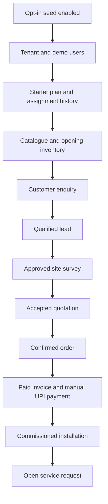

# Demo data and test users

## 1. Feature purpose

Provide opt-in, reproducible local demonstration data for platform setup and the solar business lifecycle. The default
seed creates a tenant, role-separated demo users, catalogue, subscription assignment, inventory opening stock and a
linked lead-to-service record graph.

## 2. Supported roles and permissions

- Platform Super Admin: platform plan and tenant subscription administration.
- Vendor Admin: tenant catalogue, customers, leads, quotations, surveys, orders, inventory, installation and service
  operations.
- Sales user: sales and quotation workflow permissions.
- Customer: customer portal, catalogue discovery and quotation/enquiry access.

## 3. Preconditions

Use a disposable local MySQL database. Set `SEED_DATA_ENABLED=true` (equivalent property `app.seed.enabled=true`) before
backend startup. The default is disabled. Never enable demo seeding in production or on a database containing customer
data.

## 4. Business rules

- Seed operations check stable tenant slug, user email, category names, product SKUs, plan codes and business references
  before insertion.
- Passwords are encoded using the configured `PasswordEncoder`; plaintext passwords are never stored.
- Default plans are also inserted idempotently by Flyway V45; V46–V48 extend plan/assignment history and protect history
  as append-only.
- A Starter subscription and assignment-history event are created for the demo tenant only when it has no effective
  assignment.
- Demo invoice/payment are illustrative records; the UPI payment is manually recorded and does not represent a live
  payment-gateway transaction.
- The enquiry is the existing customer request record used to initiate the quotation workflow; no duplicate
  quotation-request table is introduced.

## 5. Detailed user flow

Enable the seed flag, start the backend, sign in as Platform Super Admin, inspect Starter/Professional/Enterprise plans
and the tenant's Starter assignment. Sign in as Vendor Admin/Sales to inspect catalogue, customer, lead, quotation,
survey, order, invoice, payment, inventory, installation and service records. Sign in as Customer to inspect the
public/customer catalogue and quotation entry point.

## 6. Frontend routes and screens

- `/`: login and role-based SPA navigation.
- Customer: Our Products and Request a Solar Quotation.
- Platform: Enterprise SaaS administration, subscription plans, tenant assignment and assignment history.
- Vendor: catalogue, customer, lead, quotation, survey, order, inventory, installation and service screens.

## 7. Backend APIs

- Authentication: `POST /api/v1/auth/login`; current user: `GET /api/v1/me`.
- Platform plans: `GET/POST /api/v1/platform/subscription-plans`; update/toggle/delete use
  `/api/v1/platform/subscription-plans/{id}`.
- Tenant assignments: `GET/POST /api/v1/platform/tenants/{tenantId}/subscriptions`; history:
  `GET /api/v1/platform/tenants/{tenantId}/subscription-history`.
- Business workflow APIs are documented in files 01–10 and the end-to-end guide.

## 8. Request and response examples

Demo login credentials:

- Platform Super Admin: `platform@saumya.local / Platform@123`
- Vendor Admin: `admin@saumya.local / Admin@123`
- Sales user: `sales@saumya.local / Sales@123`
- Customer: `customer@saumya.local / Customer@123`

Successful login response shape:
`{"accessToken":"<redacted-jwt>","user":{"id":"<user-uuid>","email":"customer@saumya.local","accountType":"CUSTOMER"}}`.
Never paste live tokens into tickets or documentation.

## 9. Database entities and relationships

The demo graph includes `tenant`, `app_user`, `role`, `customer_profile`, `product_category`, `product`,
`subscription_plan`, `tenant_subscription`, `subscription_assignment_history`, `warehouse`, `inventory_balance`,
`inventory_transaction`, `enquiry`, `sales_lead`, `site_survey`, `quotation`, `quotation_item`, `customer_order`,
`order_item`, `invoice`, `payment`, `installation_job` and `service_request`. Business records are scoped to the Saumya
Solar tenant and linked by their existing IDs.

## 10. Validation rules

- Do not enable seeding against a shared or production database.
- Demo email addresses, tenant slug, product SKUs and business references must remain unique.
- All created users use the existing password encoder and role assignments.
- The demo assignment must reference the seeded Starter plan and retain its assignment-history event.
- Seeded invoice totals and payment amounts use INR and illustrative 18% GST split into CGST/SGST.

## 11. Status transitions

The demonstration graph represents: enquiry `CONVERTED` → lead `QUALIFIED` → survey `APPROVED` → quotation `ACCEPTED` →
order `CONFIRMED` → invoice `PAID` / payment `CONFIRMED` → installation `COMMISSIONED` → service request `OPEN`. The
demo tenant subscription is `ACTIVE`.

## 12. Error and edge cases

- If seeding is disabled, no demo identities or lifecycle records are inserted; V45 default plan migration remains
  independent.
- Existing demo records are reused by stable business references; do not manually delete only part of the graph and
  expect all missing dependencies to be reconstructed if its terminal service ticket already exists.
- Demo credentials are public local examples and must be changed before any shared environment.
- The manual UPI payment is not evidence of gateway connectivity or settlement.

## 13. Manual testing instructions

1. Create a disposable MySQL database and apply migrations V1–V48.
2. Set `SEED_DATA_ENABLED=true` and start the backend; check startup logs for seed exceptions.
3. Sign in using each demo account and verify role-specific navigation.
4. Verify the tenant has one active Starter assignment and an assignment-history event.
5. Inspect the enquiry, lead, approved survey, accepted quotation, confirmed order, paid invoice, confirmed UPI payment,
   inventory receipt, commissioned installation and open service ticket.
6. Restart the backend and verify no duplicate users, plans, categories, products, assignment or lifecycle records.
7. Disable the seed flag on a fresh disposable database and verify demo identities/business records are not created.

## 14. Expected results

A single tenant-scoped demo graph is visible to authorized roles; Platform Super Admin can inspect the Starter
assignment; the customer sees only customer-facing screens; rerunning the seed does not duplicate the stable demo
records.

## 15. Business flow diagram

## 16. Known limitations

- The dataset is a single-tenant local demonstration, not a production multi-tenant fixture generator.
- The UPI payment is a manual demo record; no real money movement occurs.
- The seeded invoice/customer details are fictional examples and must not be used for actual billing.
- Browser-driven cross-role E2E automation is not currently part of CI; follow `13-end-to-end-testing-guide.md` for the
  manual browser journey.
